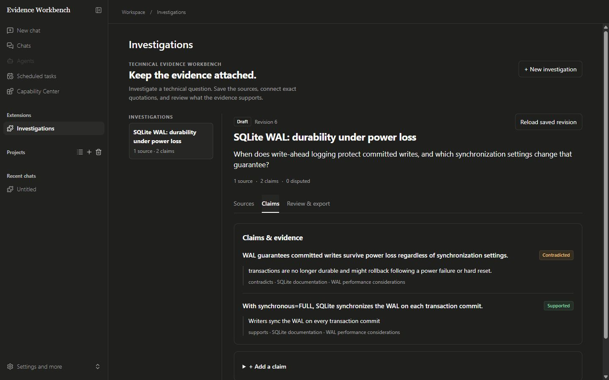
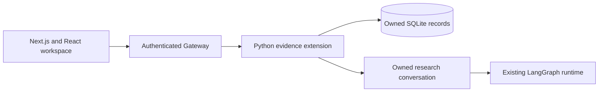

# Technical Evidence Workbench

A workspace for technical questions, saved source passages, and claims that stay linked to their evidence.

The complete DeerFlow app supplies research conversations, artifacts, tools, and the LangGraph runtime. This fork adds a persistent investigation workflow with exact quotations, visible contradictions, session-authorized review, and Markdown reports.



## What you can do

- Save immutable text snapshots with a source URL and SHA-256 hash.
- Attach exact quotations to claims as support, contradiction, or context.
- See supported, contradicted, disputed, and unsubstantiated claims separately.
- Keep concurrent edits from overwriting a newer revision.
- Review a revision and export a report that retains unresolved claims and source references.
- Prepare an owned research conversation and briefing without starting a model call.

The evidence workflow runs without model credentials. Quote matching checks the saved text. It does not verify source authenticity or establish whether a claim is true.

## Run locally

The verified development path uses Windows, Python 3.12+, Node.js 22+, and Git. Dependencies are locked with uv 0.13.3 and pnpm 10.26.2.

```powershell
git clone --branch workbench https://github.com/STEVVVU/technical-evidence-workbench.git
cd technical-evidence-workbench
python -m venv .tooling
.\.tooling\Scripts\python.exe -m pip install uv==0.13.3
cd backend
..\.tooling\Scripts\uv.exe sync --locked --python 3.12
cd ..\frontend
npx --yes pnpm@10.26.2 install --frozen-lockfile
cd ..
.\backend\.venv\Scripts\python.exe scripts/workbench.py init
```

Start the Gateway and frontend in separate terminals from the repository root.

```powershell
# Terminal 1
.\backend\.venv\Scripts\python.exe scripts/workbench.py gateway

# Terminal 2
.\backend\.venv\Scripts\python.exe scripts/workbench.py web
```

Open <http://127.0.0.1:3320> and create the local admin account on first launch. Both services bind to loopback. This path needs no Docker, nginx, provider key, or paid API call.

[Setup, configuration, and workflow details](docs/WORKBENCH.md) describe storage paths, capacity limits, research handoff, and recovery after interrupted thread preparation. Other deployment paths remain part of the [upstream documentation](README.upstream.md).

## Investigate a question

1. Create an investigation with a specific technical question.
2. Paste a relevant documentation passage, paper excerpt, or experiment output.
3. State a claim and attach quotations from the saved text. Include conflicting evidence when available.
4. Inspect the sources and unresolved claims before marking the revision reviewed.
5. Generate and download the Markdown report.

To continue with an agent, select **Prepare research chat**, copy the briefing, and open the conversation. Configure a model in the existing Models settings before sending the briefing. Preparation alone never starts a run.

## Architecture



| Component | Responsibility |
| --- | --- |
| `extensions/evidence-workbench/evidence_workbench/store.py` | Owner-scoped records, immutable snapshots, revision checks, evidence classification, review, and report export |
| `extensions/evidence-workbench/evidence_workbench/static/` | Investigation interface mounted through the existing extension host |
| `backend/` | Existing FastAPI Gateway, session authentication, CSRF, and agent runtime |
| `frontend/` | Existing TypeScript, Next.js, and React application with the workbench entry route |
| `scripts/workbench.py` | Local configuration and service launch commands |
| `scripts/verify_workbench.py` | Isolated real-product verification with retained evidence |

Every record is scoped to the authenticated owner. Research tools also require the bound conversation. Tools can add source snapshots and claims, but cannot mark an investigation reviewed. A new source or claim resets review status.

## Verification

The checked paths include invalid quotations, stale revisions, owner isolation, transaction rollback, concurrent writers, report invalidation, and persistence across a real Gateway restart. Desktop and mobile layouts were inspected at 1440×900 and 390×844. The model-free build does not claim live agent quality.

```powershell
.\backend\.venv\Scripts\python.exe -m pytest --confcutdir extensions/evidence-workbench/tests extensions/evidence-workbench/tests -q
.\backend\.venv\Scripts\python.exe scripts/verify_workbench.py --feature evidence --evidence .deer-flow/verification/my-fresh-run
cd frontend
npx --yes pnpm@10.26.2 check
npx --yes pnpm@10.26.2 exec rstest run tests/unit/core/extensions/workbench.dom.test.ts tests/unit/core/extensions/surfaces.dom.test.ts
```

The API driver creates synthetic accounts in isolated state, starts and restarts its own Gateway, checks the real actions, and stops its processes. Choose a fresh evidence directory for each run. See the [verification driver skill](.agents/skills/verify-workbench/SKILL.md) and [verification record](docs/VERIFICATION.md).

## Current scope

Sources and claims are append-only. The first version accepts supplied text snapshots; source URLs are metadata rather than automatic ingestion. It has no PDF parser, automatic entailment scorer, or implemented corrective-retrieval research result. Live research requires a configured model. Review records session authorization, not proof that a particular person inspected the evidence.

Storage and response budgets are documented in the [workbench guide](docs/WORKBENCH.md#data-and-boundaries). The [mobile screenshot](docs/images/workbench-mobile.png) shows the same evidence workflow at a narrow viewport.

## Upstream and license

Based on [ByteDance DeerFlow](https://github.com/bytedance/deer-flow), pinned to `059758f321d83dc7196e35fa99f5829333d97ec1`. The investigation extension, workbench entry route, local launch helper, and focused verification are additions in this fork. The underlying application and agent runtime are inherited.

The [MIT license](LICENSE) and upstream copyright notices are retained. The original README is preserved in [README.upstream.md](README.upstream.md).
